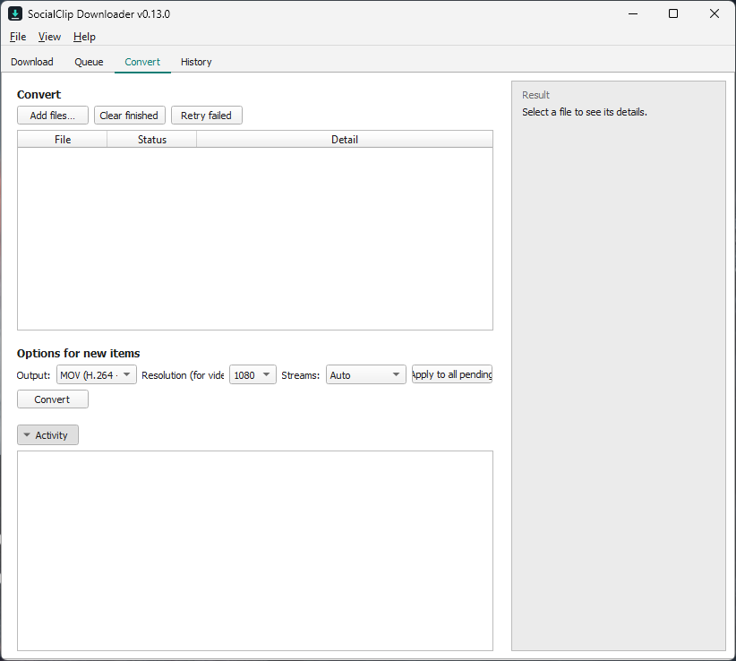
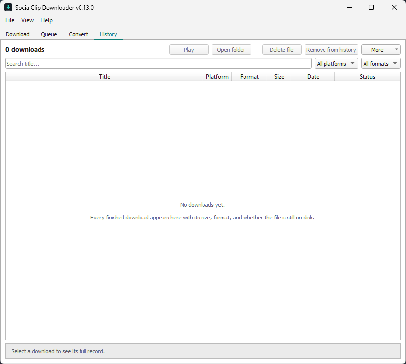

<div align="center">

# SocialClip Downloader

**Download video and audio from YouTube, TikTok, Instagram, Twitter/X, Facebook, Bilibili, Douyin, and [1000+ other sites](https://github.com/yt-dlp/yt-dlp/blob/master/supportedsites.md), in a clean desktop app or from your terminal. No ads, no redirect sites, no telemetry. Everything runs on your machine.**

[](https://github.com/petra-dot/socialclip-downloader/actions/workflows/python-package.yml)
[](https://github.com/petra-dot/socialclip-downloader/releases)
[](https://github.com/petra-dot/socialclip-downloader/releases)
[](LICENSE)
[](https://www.python.org/downloads/)

**Download a single video:** paste a link, fetch the metadata and thumbnail, then save:


<table>
  <tr>
    <td></td>
    <td></td>
    <td></td>
  </tr>
</table>

</div>

---

SocialClip Downloader is a free, open-source desktop app for saving online video
and audio for offline use. It wraps the [yt-dlp](https://github.com/yt-dlp/yt-dlp)
engine in a PyQt5 interface and exposes the same engine as a `socialclip`
command-line tool. It suits editors who need a clip locally, and anyone who wants
the original file without a third-party service in the middle.

## Why SocialClip?

- **No sketchy download sites.** No pop-ups, no fake buttons, no "your download
  is ready" traps. You paste a link, you get the file.
- **Two front-ends, one engine.** The same core powers the GUI and the CLI, so
  behavior is identical whichever you use.
- **Local and private.** Nothing is sent anywhere except the sites you download
  from. No accounts, no analytics, no telemetry.
- **Honest errors.** Per-platform messages say *why* a download failed (cookies
  needed, region-locked, network down) instead of a raw stack trace.

## Features

- **Single download.** Paste a link; the app fetches the title, thumbnail, and
  formats, then saves the file. The result panel shows the file name, format,
  resolution, size, and an editor-ready line.
- **Themes.** One accent colour (teal) across the app. **View → Theme** switches
  between **Default** (follows your OS), **Light**, and **Dark**.
- **Clip downloads.** Save only part of a video: a **Start** with an **End**, or a
  **Start** with a **Duration**. Lossless stream copy by default; **Exact cut**
  re-encodes at the precise frame.
- **Subtitles.** Choose **Off**, **Sidecar (.srt)**, **Embed**, or **Both** on the
  Download and Queue tabs. A manual track and an auto track for one language are
  written as `<base>.<lang>.srt` and `<base>.<lang>.auto.srt`.
- **Download presets.** Save a setup (format, resolution, convert toggle, filename
  options, folder, cookies) under a name and recall it. Built-ins: **Editor-safe
  1080p**, **Editor-safe 720p**, **Audio only (MP3)**, **Original quality**,
  **Archive master**; your own live in `presets.json`.
- **Persistent queue.** Add links by hand or from the clipboard, then run them with
  pause, resume, per-item cancel, and cancel all. The queue is saved to disk, so it
  survives a restart. The Queue runs up to 3 downloads at once by default; set
  **Downloads at once** (1 to 8) or use `queue run --jobs N`.
- **Bulk convert.** The Convert tab keeps a list of local files ([see below](#convert));
  add many at once or drag them in. Each row owns its target and state.
- **Live progress.** Speed, time remaining, and downloaded/total size appear next
  to the percentage, on the Download tab and in each Queue row.
- **Collection expansion.** Paste a playlist, channel, or profile URL and the Queue
  offers to add its videos, previewing the list and skipping duplicates. Reliable
  on YouTube, best-effort elsewhere.
- **Editor-safe conversion.** Remux (fast, lossless) when the streams already fit,
  otherwise re-encode. Every output is H.264 video with AAC, MP3, or PCM audio,
  ready for CapCut, Premiere Pro, After Effects, and DaVinci Resolve.
- **One output vocabulary.** `MP4 (H.264 + AAC)` and `MP3 (audio)` wherever a
  format is named, in the Download, Queue, Convert, and History tabs.
- **Health check and repair.** A built-in report covers ffmpeg, cookies, network,
  the JavaScript runtime YouTube needs, and yt-dlp's age, and repairs a missing or
  stale component from a verified download. See [Maintenance](#maintenance).
- **One writable data folder.** Cookies, the queue, the convert list, presets, the archive,
  and history live in one directory; **File → Open data folder** reveals it.
- **Cross-platform.** Windows, macOS, and Linux, with prebuilt binaries that bundle
  ffmpeg.

## Supported sites

YouTube, TikTok, Instagram, Twitter/X, Facebook, Bilibili, Douyin, and
[anything else yt-dlp supports](https://github.com/yt-dlp/yt-dlp/blob/master/supportedsites.md).
That is over a thousand sites, and it grows with each yt-dlp release. Some sites
need a cookies file; see [Cookie authentication](#cookie-authentication).

## Download and install

### Option A: prebuilt binary (no Python required)

Download the build for your operating system from the
[latest release](https://github.com/petra-dot/socialclip-downloader/releases/latest):

| Platform | GUI app | Command-line tool |
|----------|---------|-------------------|
| Windows  | `socialclip-downloader-windows.exe` | `socialclip-windows.exe` |
| macOS    | `socialclip-downloader-macos` | `socialclip-macos` |
| Linux    | `socialclip-downloader-linux` | `socialclip-linux` |

ffmpeg and a JavaScript runtime are bundled, so there is nothing else to install.

**YouTube needs a JavaScript runtime.** yt-dlp solves YouTube's challenge with
one, and the app looks for `deno`, `node`, `bun`, then `quickjs`: first on your
`PATH`, then in its own data directory, then in the bundle. The prebuilt binaries
ship deno, so YouTube works out of the box; running from source without any
runtime, YouTube downloads fail with HTTP 403, and the **Health** report says so.
Install Deno (`winget install DenoLand.Deno`, `brew install deno`) or Node.js to
fix it.

<details>
<summary><strong>First-launch notes (macOS and Linux)</strong></summary>

**macOS:** the build is not code-signed or notarized, so Gatekeeper blocks it the
first time. Either right-click the app and choose **Open → Open**, run
`xattr -dr com.apple.quarantine socialclip-downloader-macos` in Terminal, or use
**System Settings → Privacy & Security → Open Anyway**.

**Linux:** make the binary executable first:

```bash
chmod +x socialclip-downloader-linux
```

</details>

### Option B: run from source

Requires **Python 3.8+** and **ffmpeg** on your `PATH` (or set
`SOCIALCLIP_FFMPEG` to its location).

```bash
git clone https://github.com/petra-dot/socialclip-downloader.git
cd socialclip-downloader
pip install -r requirements.txt
```

Launch the GUI with `python socialclip_downloader.py`, or use the launcher for
your platform: `run.bat` (Windows) or `./run.sh` (macOS/Linux). To build a
standalone executable on Windows, run `build.bat`.

## Updates

SocialClip checks GitHub Releases at most once a day and shows a small indicator in
the top right when a newer version is out; **Help → Check for updates** forces a
check. On Windows the app downloads the new build, verifies its SHA-256 digest, and
installs it with a restart. Elsewhere it opens the release page instead.

## Command-line usage

The `socialclip` tool exposes the same engine without a display, for scripts, servers,
and AI agents. From a source checkout, run `python cli.py <command>`.

```bash
socialclip download URL [--format mp4|mp3] [--resolution 1080] [--output DIR] [--cookies FILE] [--preset NAME] [--convert|--no-convert] [--start TIME] [--end TIME] [--duration TIME] [--exact-cut] [--subtitles off|sidecar|embed|both]
socialclip convert FILE [--to KEY] [--copy|--no-copy] [--resolution 1080]
socialclip queue add URL [URL ...] [--expand]
socialclip queue list
socialclip queue run [--jobs N] [--archive]
socialclip queue retry
socialclip queue clear
socialclip queue archive --clear
socialclip doctor
socialclip repair [--dry-run]
socialclip manifest-schema
```

| Command | What it does |
|---------|--------------|
| `download` | Fetch one URL and save it as MP4 or MP3. `--preset NAME` fills unset options from a saved download preset (built-in or your own); an explicit flag wins over the preset, so `--no-convert` overrides a preset that converts. Add `--start` with `--end` or `--duration` to save only a time range (times accept `90`, `1:30`, or `00:01:30`); `--exact-cut` re-encodes at the precise frame instead of a lossless stream copy. `--subtitles off\|sidecar\|embed\|both` saves subtitle sidecars, muxes them into the video, or does both (default `off`). |
| `convert` | Convert a local file to a format key: `mp4`, `mkv`, `mov`, `avi`, `gif`, `mp3`, `m4a`, `wav`, `aac`. Streams auto-remux when they already fit; `--copy` forces a stream copy, `--no-copy` forces a re-encode. Every output is H.264 video with AAC/MP3/PCM audio, so it imports into CapCut, Premiere Pro, After Effects, and DaVinci Resolve. |
| `queue add\|list\|run\|retry\|clear\|archive` | Manage a persistent download queue that the GUI shares. `add --expand` expands a playlist, channel, or profile URL into its videos (best-effort off YouTube) and enqueues them. `run --jobs N` downloads up to `N` (1-8, default 3) at once. `run --archive` skips videos already recorded in the archive, and `queue archive --clear` resets it. `retry` re-queues every failed job. |
| `doctor` | Report ffmpeg version, cookie files found, network reachability, the JavaScript runtime YouTube needs, and how old the installed yt-dlp is. Exits `0` if ffmpeg is present, `3` otherwise. |
| `repair` | Check the components (yt-dlp, ffmpeg, the JavaScript runtime) and download a verified replacement for any that is missing, stale, or broken. `--dry-run` lists what it would repair and stops. |
| `manifest-schema` | Print the JSON Schema for structured results. |

### Machine-readable output

Add `--json` to `download`, `convert`, `doctor`, or any `queue` command to get
**exactly one JSON object on stdout** (human text goes to stderr), for scripts and agents:

```console
$ socialclip doctor --json
{"schema_version": "1.2", "ffmpeg": {"found": true, "path": "/usr/bin/ffmpeg", "version": "ffmpeg version 6.1"}, "cookies": [{"platform": "youtube", "found": false, "path": null}], "network": {"ok": true, "detail": "reachable"}, "js_runtime": {"found": true, "name": "node", "path": "/usr/bin/node", "candidates": ["deno", "node", "bun", "quickjs"]}, "ytdlp": {"version": "2026.08.19", "age_days": 58, "stale": false}}
```

Exit codes are stable: `0` success, `1` download failure, `2` usage error, `3` missing
dependency. Each failure carries a machine-readable `error_category`: `blocked`,
`cancelled`, `format`, `ffmpeg`, `network`, `not_found`, `other`, `skipped`.

## Queue

The **Queue** tab holds a table of URLs with a live status per item. Use **Add
URLs** or **Paste** to enqueue, then **Start** to download them, up to 3 at once by
default (adjust **Downloads at once** between 1 and 8). Each running row shows its
own progress (percent, speed, ETA, size) and can be cancelled on its own; **Cancel
all** stops the batch. You can also **Pause**, **Resume**, remove a pending row, or
**Clear finished**. The queue reloads on startup, so unfinished work survives a
restart.

Selecting rows shows a bulk bar with **Retry**, **Remove**, and **Clear finished**.
Every row carries a status chip, and **Options for new items** (preset, folder, format,
resolution, cookies, subtitles) is what **Start** offers to apply.

Failed a download? **Retry failed** re-queues every failed job, and right-clicking
a failed row offers the same **Retry**. Right-click a pending job and choose
**Edit options...** to change its format, resolution, folder, subtitles, and cookie
file before it runs. The CLI adds `queue retry`.

Already saved a video? Tick **Skip already downloaded** (or `socialclip queue run
--archive`) and each finished video is recorded in `archive.txt`, so the Queue skips
it next time. **Clear archive** (or `socialclip queue archive --clear`) wipes it. It
is off by default.

The GUI and the CLI share one queue file, JSON in the app's data directory (next to
the auto-detected cookie files; see [Maintenance](#maintenance)). Set
`SOCIALCLIP_QUEUE` to override the location.

## Convert

The **Convert** tab is a persistent list of local files, stored in `convert.json`
beside `queue.json`. Use **Add files…** or drag them onto the table; each row carries
its own target format, resolution, and state, and the files convert one at a time.

- Select one or more rows to show the bulk bar: **Retry**, **Remove**, or **Clear
  finished**. Right-click a row for **Edit options...**, **Retry**, **Remove**, or
  **Cancel**.
- **Options for new items** sets the format and resolution that new files inherit.
  **Apply to pending** stamps them onto every pending row; only pending rows can be
  edited.
- Selecting a row shows its target format, output path, and state, and a result
  panel on the right mirrors the Download tab. **Cancel all** stops after the
  current file and leaves the rest pending, so they can still be run. The activity
  log is visible by default and can be minimized.

Conversions remux when the streams fit the container and re-encode otherwise, and
every output is editor-safe (see [Features](#features)). The CLI takes one file:
`socialclip convert FILE --to KEY`.

## History

Every completed download is recorded, from the Download tab, the Queue, and the
CLI, in `history.json` in your data directory. The **History** tab lists them in a
sortable table with a search box and platform/format filters.

- **Play** hands the file to your operating system's default application. The app
  never bundles a media player.
- **Details** shows what was recorded at download time (title, URL, platform,
  format, resolution, duration, size, source) and probes the file on demand for its
  real container and codecs.
- **Status is checked against the disk every time you open the tab**, so a file you
  moved or deleted reads as **Not found** instead of silently looking fine.
- **Delete file** removes the file and keeps the entry, marked **Deleted by you**.
  **Remove from history** drops the entry and leaves the file alone. Both ask first,
  and only paths this app recorded are ever touched.

## Maintenance

SocialClip checks the components it depends on (yt-dlp, ffmpeg, and the JavaScript
runtime YouTube needs) **at most once a day**, in the background. When one is
missing, stale (yt-dlp older than 90 days), or broken, it downloads a replacement
into the data directory, verifies its SHA-256 against the publisher's checksum
file, and only then swaps it in. A bad download never replaces a working copy.

- **Health view:** open **Help → Health** for each component's version and state,
  plus **Repair** and **Open data folder**. **Help → Check components** forces a
  check now instead of waiting for the daily one.
- **Open data folder:** **File → Open data folder** (or the Health view button)
  reveals the per-user directory holding cookies, the queue, the convert list,
  presets, the archive, and the downloaded components.
- **Command line:** `socialclip repair`, or `socialclip repair --dry-run` to list
  changes and stop.

A repaired yt-dlp runs on the **next** download only after a restart: the process
already loaded the old extractor, so the Health view and `socialclip repair` say
"restart to use the new version". ffmpeg and deno take effect immediately.

Platform coverage is honest about its gaps: **macOS has no verified automatic ffmpeg
source**, so `repair` refuses to install ffmpeg there and points at `brew install
ffmpeg` or `SOCIALCLIP_FFMPEG`; yt-dlp and deno still repair automatically.

## Cookie authentication

Some platforms block automated downloads unless you are signed in. You can supply
cookies from an installed browser, from a per-platform file, or both.

**From an installed browser.** Open **File → Cookies** and pick one browser (Chrome,
Firefox, Edge, Brave, and others). That choice applies to every download; the CLI
exposes the same source as `download --cookies-from-browser` and `queue add
--cookies-from-browser`.

**From a cookies file.** Export the site's cookies and let the app auto-detect
them, or point to the file directly. A per-platform file, when present, wins over
the browser choice.

1. Install the **"Get cookies.txt LOCALLY"** browser extension.
2. Sign in, export the cookies, and save the file as `<platform>_cookies.txt` in the
   app's data directory (see [Maintenance](#maintenance)).
3. The app auto-detects the file when you fetch, or point to it with **Browse** or
   `--cookies`.

Recognized filenames: `youtube_cookies.txt`, `douyin_cookies.txt`, `instagram_cookies.txt`,
`twitter_cookies.txt`, `tiktok_cookies.txt`, `bilibili_cookies.txt`, `facebook_cookies.txt`.

> [!WARNING]
> Cookie files are credentials. Keep them out of version control: the bundled
> [`.gitignore`](.gitignore) and the CI [gitleaks](.github/workflows/gitleaks.yml)
> scan already exclude and flag them. Never share an exported cookies file.

## Troubleshooting

- **Downloads fail or merge badly:** ffmpeg is missing or not on your `PATH`. The
  prebuilt binaries include it; running from source does not. Run `socialclip
  doctor` (or open **Help → Health**) to confirm what the app sees.
- **"Blocked" / "sign in to confirm" errors:** the site wants cookies. See
  [Cookie authentication](#cookie-authentication).
- **A site is not supported:** support comes from yt-dlp. Try updating it (`pip
  install -U yt-dlp`) before filing an issue.

## Development

```bash
pip install -r requirements-dev.txt   # pytest + flake8
python -m pytest -q                   # run the test suite
python -m flake8 . --count --select=E9,F63,F7,F82 --statistics
```

The test suite covers the pure logic (cookies, format registry, conversion planning,
queue state, error classification). The Qt GUI is verified manually. See
[AGENTS.md](AGENTS.md) for the architecture and [CONTRIBUTING.md](CONTRIBUTING.md) to
contribute.

## Project structure

```
socialclip-downloader/
├── socialclip_downloader.py   entry point (re-exports the version)
├── cli.py                     socialclip command-line tool
├── core/                      Qt-free logic shared by GUI and CLI
│   ├── version.py             app version, importable without Qt
│   ├── download.py            one download end to end
│   ├── convert.py             remux / transcode engine
│   ├── formats.py             output-format registry
│   ├── probe.py               ffprobe wrapper
│   ├── queue.py               persistent download queue
│   ├── convert_queue.py       persistent convert list
│   ├── history.py             download history
│   ├── presets.py             named download presets (built-ins + user file)
│   ├── doctor.py              health report
│   ├── manifest.py            structured result contract
│   └── pipeline.py            post-processing decisions
├── ui/                        PyQt5 interface (tabs, dialogs, style)
├── workers/                   Qt worker threads
├── sites/                     platform detection, cookies, errors
├── utils/                     ffmpeg discovery, filenames, yt-dlp options
├── tests/                     pytest suite
└── docs/                      specs, plans, screenshots
```

## Contributing

Contributions are welcome. File bugs and feature requests as
[issues](https://github.com/petra-dot/socialclip-downloader/issues); for code, see
[CONTRIBUTING.md](CONTRIBUTING.md). Report security issues privately per
[SECURITY.md](SECURITY.md).

## License

Released under the [MIT License](LICENSE).

SocialClip Downloader is a front-end for [yt-dlp](https://github.com/yt-dlp/yt-dlp).
Please respect the copyright of the content you download and the terms of service
of the sites you use.
