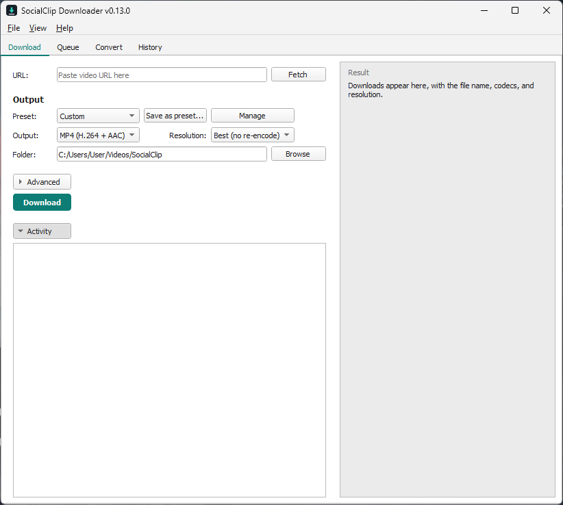
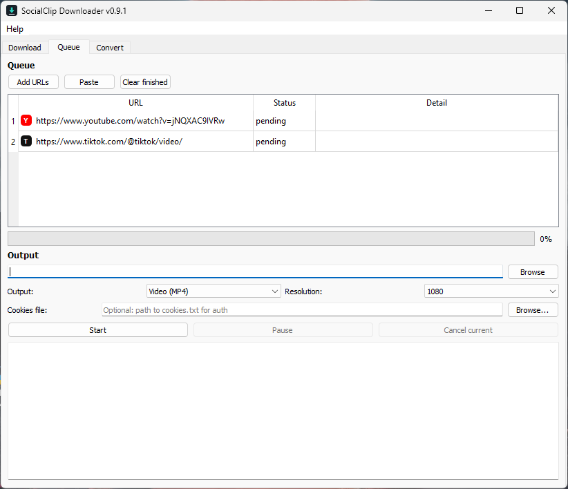

<div align="center">

# SocialClip Downloader

**Download video and audio from YouTube, TikTok, Instagram, Twitter/X, Facebook, Bilibili, Douyin, and [1000+ other sites](https://github.com/yt-dlp/yt-dlp/blob/master/supportedsites.md) — in a clean desktop app or from your terminal. No ads, no redirect sites, no telemetry. Everything runs on your machine.**

[](https://github.com/petra-dot/socialclip-downloader/actions/workflows/python-package.yml)
[](https://github.com/petra-dot/socialclip-downloader/releases)
[](LICENSE)
[](https://www.python.org/downloads/)

**Download a single video:** paste a link, fetch metadata and a thumbnail, then download:



**Queue a batch:** each row shows a platform badge, its status, and the result:



</div>

---

SocialClip Downloader is a free, open-source desktop application for saving
online video and audio for offline viewing. It wraps the battle-tested
[yt-dlp](https://github.com/yt-dlp/yt-dlp) engine in a simple PyQt5 interface,
and exposes the same engine as a `socialclip` command-line tool for scripting
and automation.

Use it to download a single video, queue a batch of URLs overnight, extract the
audio track as MP3, or convert an existing file into another format — all
without uploading anything to a third-party service.

## Why SocialClip?

- **No sketchy download sites.** No pop-ups, no fake buttons, no "your download
  is ready" traps. You paste a link, you get the file.
- **Two front-ends, one engine.** The same download and conversion core powers
  the GUI and the `socialclip` CLI, so behavior is identical whichever you use.
- **Local and private.** Nothing is sent anywhere except the sites you download
  from. No accounts, no analytics, no telemetry.
- **Honest errors.** Per-platform messages tell you *why* a download failed
  (cookies needed, region-locked, network down) instead of a raw stack trace.

## Features

- **Single download** — paste a URL and metadata is fetched automatically;
  preview the thumbnail, download as MP4 or MP3, then **Open folder** to reveal
  the saved file.
- **Clip downloads** — tick **Clip** to save only a time range: set a **Start**
  with an **End**, or a **Start** with a **Duration**. The cut is lossless
  (stream copy) by default; enable **Exact cut** to re-encode at the precise
  frame.
- **Subtitles** — choose **Off**, **Sidecar**, **Embed**, or **Both**. Sidecar
  writes `.srt` files next to the video, **Embed** muxes the tracks into the
  video, and **Both** does each. Every language the source offers is fetched,
  and a human-made track and an auto-generated track for the same language are
  saved as separate files (`<base>.<lang>.srt` and `<base>.<lang>.auto.srt`).
  The control is on the Download and Queue tabs, and the CLI adds
  `--subtitles off|sidecar|embed|both`.
- **Persistent queue** — add multiple URLs (type them, or paste from the
  clipboard), then run them with pause, resume, per-item cancel, and cancel-all.
  The queue is saved to disk, so it survives a restart.
- **Parallel downloads** — the Queue downloads up to 3 videos at once by
  default; set **Downloads at once** between 1 and 8 (or use
  `queue run --jobs N`). Each running download shows its own progress and can be
  cancelled on its own, while **Cancel all** stops the batch.
- **Collection expansion** — paste a playlist, channel, or profile URL and the
  Queue offers to add its videos: preview the list, confirm, and duplicates are
  skipped. Reliable on YouTube, best-effort elsewhere.
- **File converter** — convert a local file to any supported format, with
  automatic remux (fast, lossless) when the streams already fit the container.
  Every output is editor-safe: H.264 video with AAC/MP3/PCM audio, so it
  imports into CapCut, Premiere Pro, After Effects, and DaVinci Resolve.
- **Format control** — choose a target resolution (720p / 1080p / 1440p /
  2160p), extract audio, or copy streams when the codecs are already
  editor-safe (a forced copy of a hostile codec is re-encoded).
- **Download presets** — save a whole download setup (output format, resolution,
  convert toggle, filename options, save folder, cookies) under a name and recall
  it from the Download and Queue tabs. Editor-first built-ins — **Editor-safe
  1080p**, **Editor-safe 720p**, **Audio only (MP3)**, **Original quality**, and
  **Archive master** — ship in the app; your own presets are stored in
  `presets.json` next to the app. On the Download tab use **Save as preset...**
  and **Manage** to add, rename, or delete your presets.
- **Health check** — a built-in **Doctor** report covers ffmpeg, cookie files,
  and network reachability, so you can fix problems before a download fails.
- **Cross-platform** — Windows, macOS, and Linux, with prebuilt binaries that
  bundle ffmpeg.

## Supported sites

YouTube, TikTok, Instagram, Twitter/X, Facebook, Bilibili, Douyin, and
[anything else yt-dlp supports](https://github.com/yt-dlp/yt-dlp/blob/master/supportedsites.md)
— that is over a thousand sites, and it grows with each yt-dlp release.

Some sites need a cookies file to download; see
[Cookie authentication](#cookie-authentication).

## Download and install

### Option A — Prebuilt binary (no Python required)

Download the build for your operating system from the
[latest release](https://github.com/petra-dot/socialclip-downloader/releases/latest):

| Platform | GUI app | Command-line tool |
|----------|---------|-------------------|
| Windows  | `socialclip-downloader-windows.exe` | `socialclip-windows.exe` |
| macOS    | `socialclip-downloader-macos` | `socialclip-macos` |
| Linux    | `socialclip-downloader-linux` | `socialclip-linux` |

ffmpeg is bundled, so there is nothing else to install.

<details>
<summary><strong>First-launch notes (macOS and Linux)</strong></summary>

**macOS** — the build is not code-signed or notarized, so Gatekeeper blocks it
the first time. Either right-click the app and choose **Open → Open**, run
`xattr -dr com.apple.quarantine socialclip-downloader-macos` in Terminal, or use
**System Settings → Privacy & Security → Open Anyway**.

**Linux** — make the binary executable first:

```bash
chmod +x socialclip-downloader-linux
```

</details>

### Option B — Run from source

Requires **Python 3.8+** and **ffmpeg** on your `PATH` (or set
`SOCIALCLIP_FFMPEG` to its location).

```bash
git clone https://github.com/petra-dot/socialclip-downloader.git
cd socialclip-downloader
pip install -r requirements.txt
```

Launch the GUI with `python socialclip_downloader.py`, or use the launcher for
your platform: `run.bat` (Windows) or `./run.sh` (macOS/Linux).

## Updates

SocialClip checks GitHub Releases for a newer version at most once a day and
shows a small indicator in the top right when one is out. **Help → Check for
updates** forces a check. On Windows the app downloads the new build, verifies
its SHA-256 digest, and installs it with a restart. On macOS and Linux, and when
running from source, the indicator opens the release page instead.

## Command-line usage

The `socialclip` tool exposes the same engine without a display — useful for
scripts, servers, and AI agents. From a source checkout, run
`python cli.py <command>`.

```bash
socialclip download URL [--format mp4|mp3] [--resolution 1080] [--output DIR] [--cookies FILE] [--preset NAME] [--start TIME] [--end TIME] [--duration TIME] [--exact-cut] [--subtitles off|sidecar|embed|both]
socialclip convert FILE [--to KEY] [--copy|--no-copy] [--resolution 1080]
socialclip queue add URL [URL ...] [--expand]
socialclip queue list
socialclip queue run [--jobs N] [--archive]
socialclip queue clear
socialclip queue archive --clear
socialclip doctor
socialclip manifest-schema
```

| Command | What it does |
|---------|--------------|
| `download` | Fetch one URL and save it as MP4 or MP3. `--preset NAME` fills unset options from a saved download preset (built-in or your own); an explicit flag wins over the preset. Add `--start` with `--end` or `--duration` to save only a time range (times accept `90`, `1:30`, or `00:01:30`); `--exact-cut` re-encodes at the precise frame instead of a lossless stream copy. `--subtitles off|sidecar|embed|both` saves subtitle sidecars, muxes them into the video, or does both (default `off`). |
| `convert` | Convert a local file to a format key: `mp4`, `mkv`, `mov`, `avi`, `gif`, `mp3`, `m4a`, `wav`, `aac`. Streams auto-remux when they already fit; `--copy` forces a stream copy, `--no-copy` forces a re-encode. Every output is H.264 video with AAC/MP3/PCM audio, so it imports into CapCut, Premiere Pro, After Effects, and DaVinci Resolve. |
| `queue add\|list\|run\|clear\|archive` | Manage a persistent download queue that the GUI shares. `add --expand` expands a playlist, channel, or profile URL into its videos (best-effort off YouTube) and enqueues them. `run --jobs N` downloads up to `N` (1-8, default 3) at once. `run --archive` skips videos already recorded in the archive, and `queue archive --clear` resets it. |
| `doctor` | Report ffmpeg version, cookie files found, and network reachability. Exits `0` if ffmpeg is present, `3` otherwise. |
| `manifest-schema` | Print the JSON Schema for structured results. |

### Machine-readable output

Add `--json` to `download`, `convert`, `doctor`, or any `queue` command to get
**exactly one JSON object on stdout** (human-readable text goes to stderr), so
results can be parsed directly by a script or an agent:

```console
$ socialclip doctor --json
{"schema_version": "1.1", "ffmpeg": {"found": true, "path": "/usr/bin/ffmpeg", "version": "ffmpeg version 6.1"}, "cookies": [{"platform": "youtube", "found": false, "path": null}], "network": {"ok": true, "detail": "reachable"}}
```

Exit codes are stable: `0` success, `1` download failure, `2` usage error,
`3` missing dependency. Each failure carries a machine-readable
`error_category` (`blocked`, `format`, `ffmpeg`, `network`, `not_found`,
`cancelled`, `other`).

## Queue

The **Queue** tab holds a table of URLs with a live status per item. Use
**Add URLs** or **Paste** to enqueue, then **Start** to download them — up to 3
at once by default, adjustable with **Downloads at once** (1 to 8). Each running
row shows its own progress, a running row can be cancelled on its own, and
**Cancel all** stops the batch. While running you can **Pause** / **Resume**,
cancel an individual pending row, or **Clear finished** to drop everything in a
terminal state. The queue reloads on startup, so unfinished work is still there
after a restart.

Already saved a video? Tick **Skip already downloaded** on the Queue tab (or run
`socialclip queue run --archive`) and each finished video is recorded in
`archive.txt`, so the Queue skips anything it has downloaded before. The archive
sits beside `queue.json`; **Clear archive** (or `socialclip queue archive
--clear`) wipes it and starts fresh. It is off by default.

The GUI and the CLI share one queue file, stored as JSON in your app config
directory (next to the auto-detected cookie files). Set `SOCIALCLIP_QUEUE` to
override the location.

## Cookie authentication

Some platforms block automated downloads unless you are signed in. To supply
cookies:

1. Install the **"Get cookies.txt LOCALLY"** browser extension.
2. Sign in to the site, export the cookies, and save the file as
   `<platform>_cookies.txt` in the app directory.
3. The app auto-detects the file when you fetch. You can also point to it
   manually with the **Browse** button or `--cookies`.

Recognized filenames: `youtube_cookies.txt`, `douyin_cookies.txt`,
`instagram_cookies.txt`, `twitter_cookies.txt`, `tiktok_cookies.txt`,
`bilibili_cookies.txt`, `facebook_cookies.txt`.

> [!WARNING]
> Cookie files are credentials. Keep them out of version control — the bundled
> [`.gitignore`](.gitignore) and the CI [gitleaks](.github/workflows/gitleaks.yml)
> scan already exclude and flag them. Never share an exported cookies file.

## Troubleshooting

- **Downloads fail or merge badly** — ffmpeg is missing or not on your `PATH`.
  The prebuilt binaries include it; running from source does not. Run
  `socialclip doctor` (or open **Help → Doctor**) to confirm what the app sees.
- **"Blocked" / "sign in to confirm" errors** — the site wants cookies. See
  [Cookie authentication](#cookie-authentication).
- **A site is not supported** — support comes from yt-dlp. Try updating it
  (`pip install -U yt-dlp`) before filing an issue.

## Development

```bash
pip install -r requirements-dev.txt   # pytest + flake8
python -m pytest -q                   # run the test suite
python -m flake8 . --count --select=E9,F63,F7,F82 --statistics
```

The test suite covers the pure logic (cookies, format registry, conversion
planning, queue state, error classification). The Qt GUI is verified manually.
See [AGENTS.md](AGENTS.md) for the architecture and conventions, and
[CONTRIBUTING.md](CONTRIBUTING.md) before opening a pull request.

## Project structure

```
socialclip-downloader/
├── socialclip_downloader.py   entry point + version
├── cli.py                     socialclip command-line tool
├── assets/                    app icon and its generator
├── core/                      Qt-free logic shared by GUI and CLI
│   ├── download.py            one download end to end
│   ├── convert.py             remux / transcode engine
│   ├── formats.py             output-format registry
│   ├── probe.py               ffprobe wrapper
│   ├── queue.py               persistent download queue
│   ├── presets.py             named download presets (built-ins + user file)
│   ├── doctor.py              health report
│   ├── manifest.py            structured result contract
│   └── pipeline.py            post-processing decisions
├── ui/                        PyQt5 interface (tabs, dialogs)
├── workers/                   Qt worker threads
├── sites/                     platform detection, cookies, errors
├── utils/                     ffmpeg discovery, filenames, yt-dlp options
├── tests/                     pytest suite
└── docs/                      specs, plans, screenshots
```

## Contributing

Contributions are welcome. Bug reports and feature requests are best filed as
[issues](https://github.com/petra-dot/socialclip-downloader/issues); for code
changes, see [CONTRIBUTING.md](CONTRIBUTING.md). Please report security issues
privately as described in [SECURITY.md](SECURITY.md), not in a public issue.

## License

Released under the [MIT License](LICENSE).

SocialClip Downloader is a front-end for [yt-dlp](https://github.com/yt-dlp/yt-dlp).
Please respect the copyright of the content you download and the terms of
service of the sites you use.
